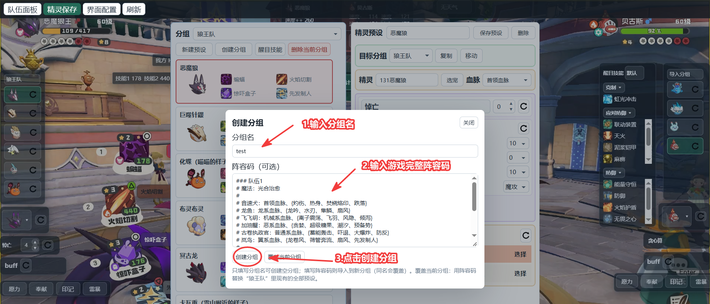
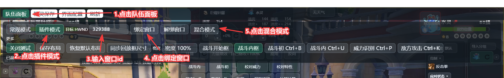
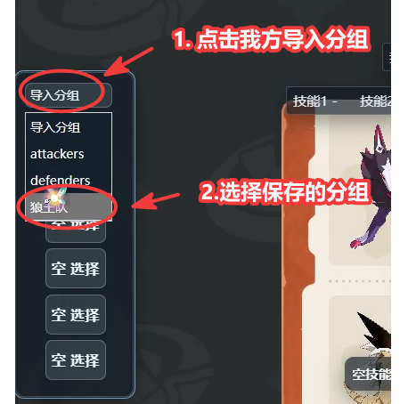
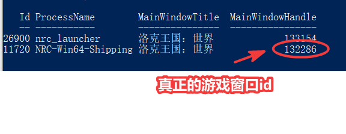
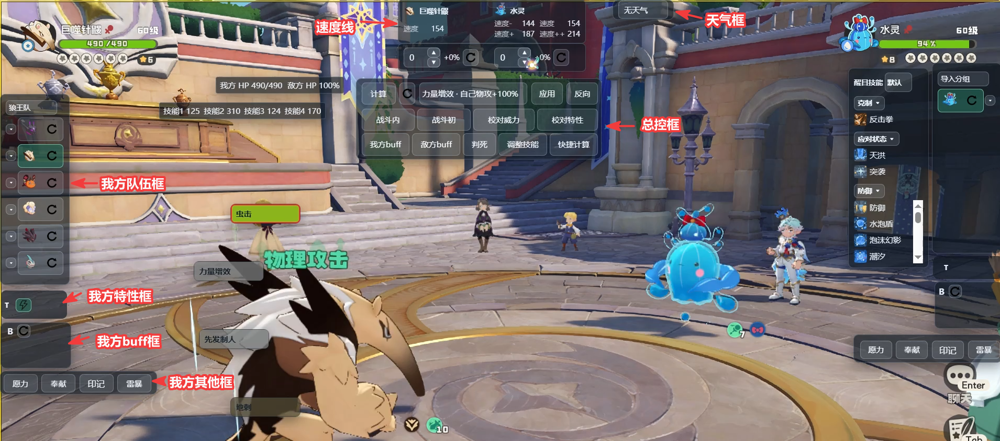
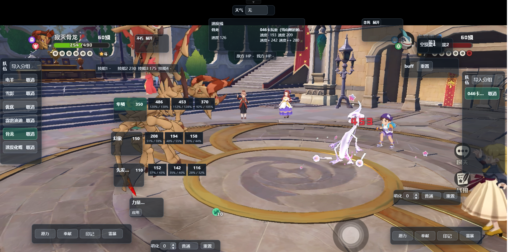
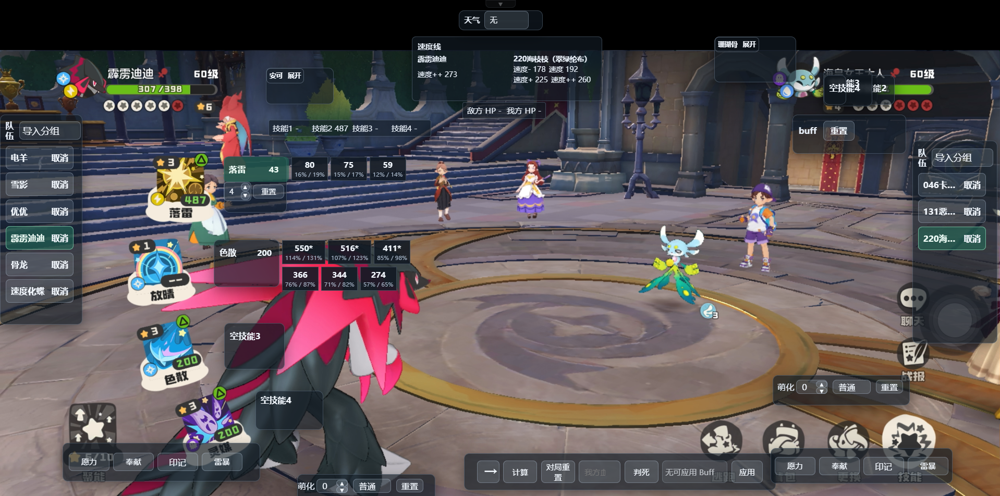
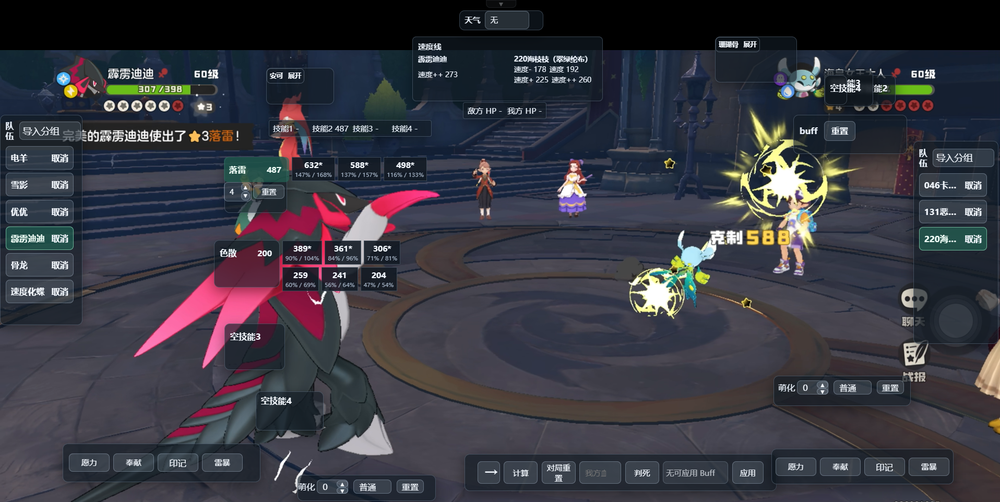
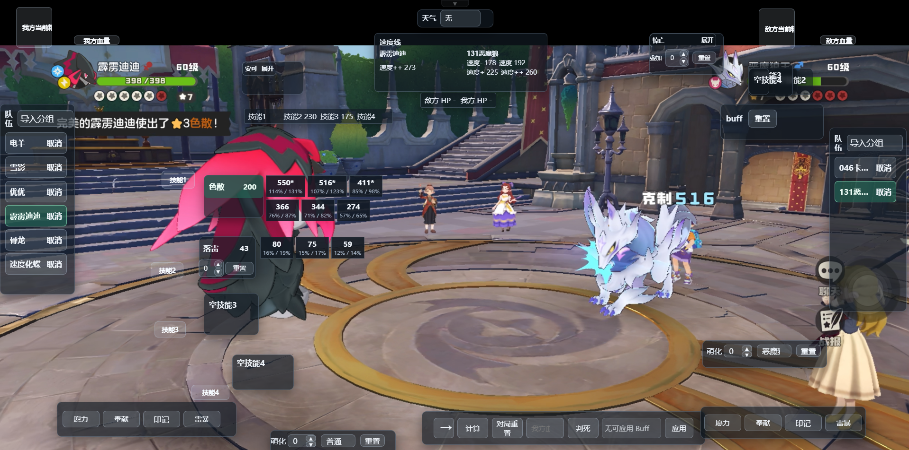

# 项目介绍
这是一个用于洛克王国世界 PVP 的伤害计算器。

支持保存完整阵容信息，并模拟游戏中的技能、特性、天气等战斗机制。

目前已经同步至S5版本

优点:
- 快速计算是否可以斩杀,伤害结果足够精确
- 轻量快速，识别精灵和识别数字都是自己训练的模型，足够快速和轻量
- 不读取任何游戏文件
- 模拟游戏内的绝大部分效果
- 减少pvp成本学习

缺点:
- 需要玩家手动维护战斗数据 
- 精灵和技能图像需要自己爬取
- ui很差
- 为了追求精确计算，导致数字和框太多
- 需要对插件有一定的熟悉程度
- 部分特殊特性不支持（如银月狼王，加尔，彩虹独角兽的七个技能框）
- 本人开发经验不足

## 目录
- [下载](#下载)
- [简单使用](#简单使用)
- [插件模式](#插件模式)
  - [获取窗口id](#获取窗口ID)
  - [校对识别框](#校对识别框)
  - [效果截图](#效果截图)
- [数据来源](#数据来源)
- [已知问题](#已知问题)
- [后续计划](#后续计划)
- [致谢](#致谢)

## 下载
[下载 Windows 安装程序](https://github.com/180sans/roco-cal/releases)
下载后直接安装即可。

> 注意：由于当前版本尚未进行代码签名，Windows SmartScreen 可能提示“Windows 已保护你的电脑”，安装程序也可能显示为“未认证”。

## 简单使用
1. 使用管理员运行.exe(（由于需要绑定窗口，需要管理员运行避免权限问题）)
2. 点击"精灵保存"->"阵容码" 将游戏阵容码导入，输入分组名



3. 点击"队伍面板"->"插件模式"->[获取游戏窗口ID](#获取窗口ID)->点击"绑定窗口"->点击"混合模式"



4. 开始前需要[校对识别框](./操作指南.md#必要操作)，分别为"战斗内框"和"战斗开始框"。战斗内框包含双方精灵图像识别框和血量框，以及我方技能威力框；战斗开始框为对战开始时敌方精灵阵容展示的六个精灵识别框

5. 将保存的队伍导入我方队伍分组



6. ctrl+u识别敌方精灵后，可以使用ctrl+j进行快速计算。


初步说明见[插件模式](#插件模式)。

**重要**: 如果需要长期稳定使用，请务必仔细阅操作指南[操作指南](./操作指南.md)

本项目采用模型识别和游戏效果模拟的方式进行计算，涉及一定的配置、校对和操作要求，不能便捷使用，存在一定的学习成本

## 插件模式
- 需要获取并绑定[游戏窗口ID](#获取窗口ID)。本项目**不读取任何游戏文件**，采用视频验证是一样的
- 点击**混合模式**进入游戏和插件混合交互状态
- 蓝色边框固定为我方框，红色边框固定为敌方框
- 长按框中心可以自由拖动，滑动边缘可以调节大小。需要点击"更多"->"保存布局"来保存修改。详见[操作指南](./操作指南.md)

### 快捷操作
- 在进入混合模式后，按下F8，可以回到插件。（如果没有反应，按下windows后，点击游戏，再按F8）
- F9完全收缩/展开程序. （如果没有反应，按下windows后，点击游戏，再按F9）
- ctrl+j 快速计算，结果简单的出现在技能的右侧
- 伤害说明:
  - 在攻击方指定天分和性格的情况下，计算会出现三个伤害，代表着防御方的对应物防/魔防的"防御+"，"防御"，"防御-"
  - 在每个伤害对应两个百分比血量"生命++"和"生命+"，百分比向下取整，游戏内的百分比是向上取整的，所以**如果计算百分比大于当前血量百分比，一定可以击杀**
- ctrl+b 战斗开始识别，可用于战斗开始快捷导入敌方阵容
- ctrl+u 战斗内识别，识别双方当前精灵和血量
- ctrl+p 校准威力（识别技能威力，对应位置的技能有叠层还会自动修正叠层，目前的模式不支持传动）
- ctrl+k 判断敌方精灵是否击杀自己，可以选择某个技能计算（不完善）
- ctrl+t 校对特性，通过技能威力来校对影响技能威力的特性，需要提前保证我方攻击buff正确
- ctrl+I/o 我方/敌方所有技能buff面板，用于快捷应用我方/敌方buff
- ctrl+Y 调整技能顺序，选择其他技能。主要用于处理传动和临时更换技能的情况

### 获取窗口ID

使用 PowerShell 命令获取窗口 ID（`MainWindowHandle` 下的数字）。

需要注意的是，会有两个窗口：一个是启动器窗口（launcher），另一个（NRC-Win64-Shipping）才是游戏窗口。

```powershell
Get-Process | Where-Object {$_.MainWindowTitle -like "*洛克王国*"} | Select-Object Id, ProcessName, MainWindowTitle, MainWindowHandle
```



### 框效果说明
 

- 队伍框: 导入已有分组
- 速度线框：查看双方速度分布。采用++，+，无，-来展示速度相应的天分和性格。数字框代表的是常规速度buff. 其中%是无法通过buff来增加的,因此无法手动调节，只做为展示
- buff框：点击后将展开详细的buff列表，出现buff后会在buff框中显式表现出来
- 萌化框：精灵的萌化buff，具有首领化的精灵可以点击"普通"来选择首领化
- 其他项框：奉献，愿力，星陨，雷暴都做了初版框架。但是目前愿力，星陨，雷暴不完善
- 天气框：目前只有雨天会影响战斗
- 醒目技能框：精灵保存界面运行你自由加入技能（比如倾斜），敌方精灵有该技能时会提醒出来

### 效果截图
图片素材来自本人录制的视频，**非实时**演示。目前项目不完善，还需要改进

可以看到造成的伤害是隼麟的第二项，453


这里只有**技能2**显示威力的原因是我没有重新导入数据，所以技能识别的位置是第二个技能。由于这是手机录的，这里的识别位置不正确，其他技能也没有正确识别威力
 

 

这里的色散的计算结果中用*表明的就是技能的触发情况
 

## 数据来源
- 计算公式系数来源于 [b站up主血羽纷落](https://space.bilibili.com/329859964)
- 精灵数据来源于 [b站洛克王国世界wiki](https://wiki.biligame.com/rocom)

## 已知问题
- 黑（白）加尔特性没有实现
- 配置界面的说明不完善，处于测试状态

## 后续计划
- 针对这类多次行动的技能实现（如吹火，乘胜追击等第二次结果和第一次不一致的情况），目前实现部分
- 完善部分尚未实现的特性。
- 完善 Buff 标签显示。

## 致谢
- [Linux Do](https://linux.do) — 感谢社区提供的交流平台。
