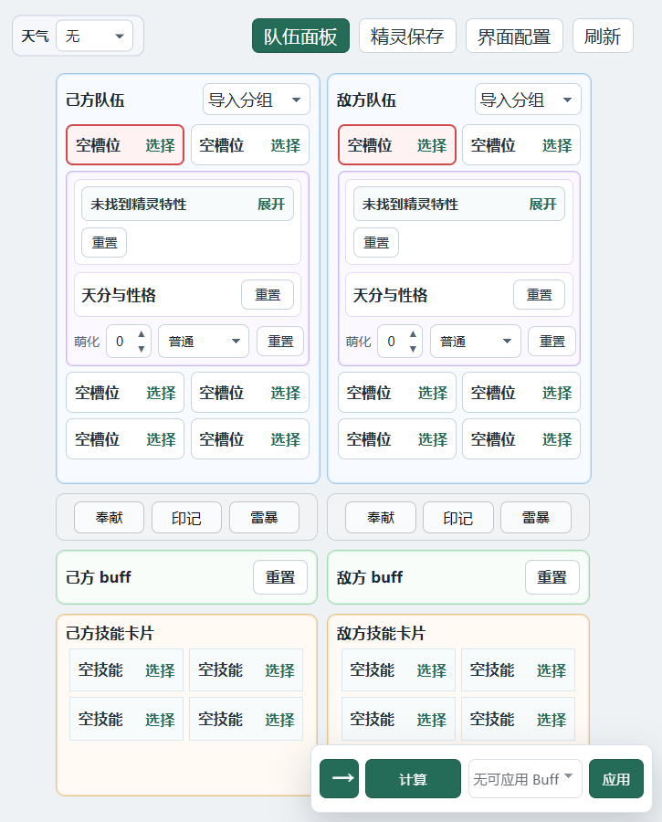
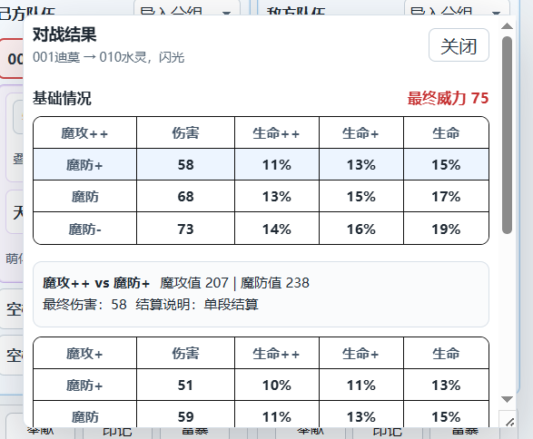
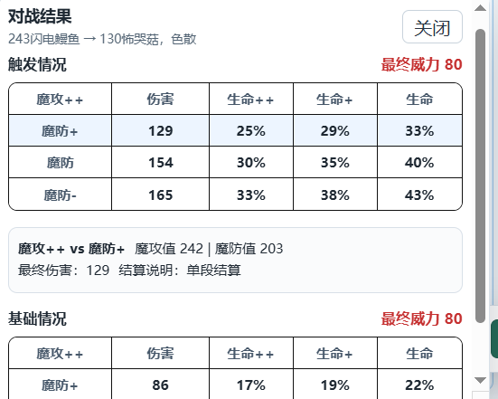
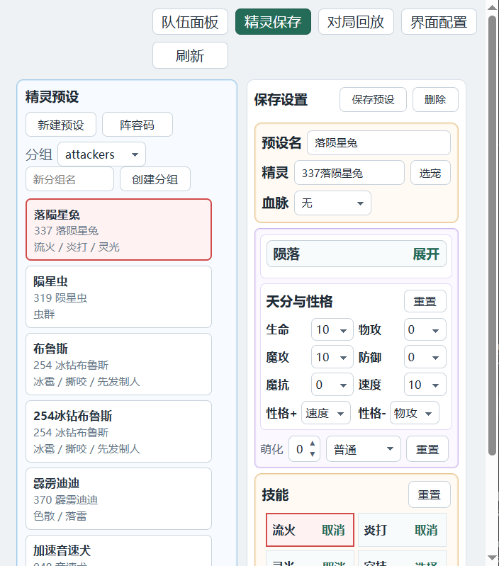

## 常规模式
已暂停更新

### 计算
- 支持常规计算，对于敌方天分无的情况会有一个预设来决定敌方天分和性格（预设为防御+， 防御，防御-.生命++，生命+，生命）
- 计算结果中"++"代表性格和天分双加成，"+"代表只有天分，"-"代表性格减益。 一般不会出现防御性格增益也不会出现生命减益，故默认防御没有++，生命没有-

### 阵容保存
- 保存技能,精灵，天分内容。可直接输入游戏内完整阵容码来进行快捷导入。
- 强烈建议保存自己的阵容所有数值，否则计算结果界面会有很多数值结果
- 可在队伍面板中直接导入以保存阵容

### 战斗相关特性
- 实现绝大部分的战斗相关特性
- 如特殊条件类，如星光狮，鸭吉吉（需要点击触发按钮）
- 部分特性为被动（如泥吼呀，独角兽），会自动结算
- 叠层特性可以手动输入层数
- 保存界面可以指定是否默认触发（针对巨噬针鼹），首领化，以及叠加层数（针对蜂后）

### 技能触发情况
- 特殊触发技能的计算结果中会带有两种情况的展示，触发情况和基础情况
- 可叠层特性需要自己输入层数（如果不知道自己叠了几层，可以点击计算结果来看威力和游戏内是否一致）

### 首领化和萌化
- 首领化针对棋绮后做了特殊处理，不会替换原本的特性

### buff类技能快速叠加
- 如嘲弄等叠buff技能可以直接快速应用，会给相应目标对应的buff(目前标签不完善)

### 其他功能
#### 天气
- 目前只有雨天对战斗有影响

#### 奉献
- 目前有奉献的威力增加+以及连击加成

#### 雷暴
- 雷暴面板中有选用的技能，选择后代表雷暴目前已经记录这个技能
- 战斗中，如果电流刺激特性触发并且（星光狮特性）没有记录在雷暴面板，两次雷暴（面板中有电流脉冲）伤害会不一致，这点和游戏一致

#### 印记
- 给敌方设置星陨印记层数在引爆时会自动星陨印记的伤害（目前伤害未分离）
- 对应的支持蓄势印记，蓄电印记（需要手动点击触发），攻击印记

## 界面展示

### 主界面

计算左边的箭头代表攻击方向，应用代表应用buff\
\

### 计算结果
常规计算结果，表格中左上角代表着攻击方精灵的攻击属性（如下图中的魔攻++和魔攻+），表格的防御和生命属性代表受击方的属性，生命占比为向下取整（目前了解敌方精灵显示血量%是向上取整的）\
\
\
技能的触发情况\
\
\

### 队伍保存

