## 目录
- [基本知识](#基本知识)
  - [拖动布局](#拖动布局)
  - [保存布局](#保存布局)
- [必要操作](#必要操作)
  - [校对战斗内框](#校对战斗内框)
  - [校对战斗开始框](#校对战斗开始框)
  - [获取图像](#获取图像)
- [必要操作](#必要操作)
- [按钮和快捷键含义](#按钮和快捷键含义)
- [伤害技能模拟](#伤害技能模拟)
- [萌化和首领化](#萌化和首领化)

## 基本知识

### 拖动布局

插件模式下，长按所有的框（识别框，速度线等），变为手势，手势下可以自由拖动位置，调整到你喜欢的位置上

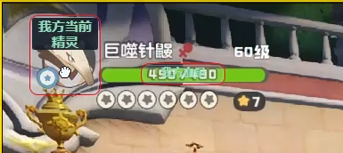

滑动边缘可以调整框的大小，避免出现某些显示不全的问题

### 保存布局
点击"保存布局"可以保存当前插件模式下所有的布局

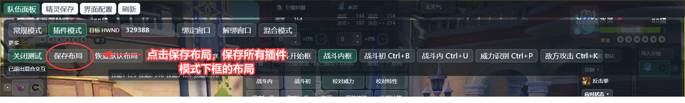

## 必要操作
如果你想长期的使用本插件，**必需**校对识别框和获取图像，否则无法长久的使用

### 校对战斗内框
绑定窗口后找个野怪进行测试来进行必要的校对。**战斗内框**：包含 4 个技能框、2 个角色图像框和 2 个血量框，用于识别战斗中的双方状态。
  
1. 非混合模式下，点击更多
2. 点击战斗内框
3. 点击混合模式

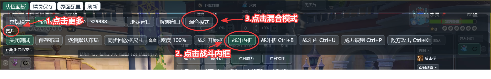

4. 自由调节框的位置
5. 按下快捷键来测试是否正确
6. 保存布局，避免下次需要重新校对

我方精灵和血量识别校对框示例

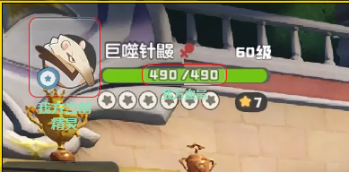

敌方精灵和血量识别校对框示例

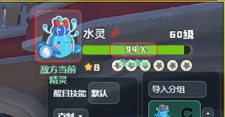

注意事项
1. 血条不要在框里。血条的左边应该刚刚好是框的右边
2. 下方里精灵的间距不要太大

技能威力识别框示例

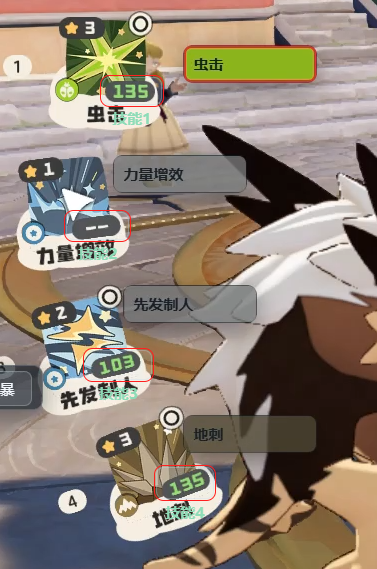

注意事项
1. 技能威力识别要保证识别框大小刚刚好不要太大  然后威力数值位置局中

校对后按下快捷键进行测试

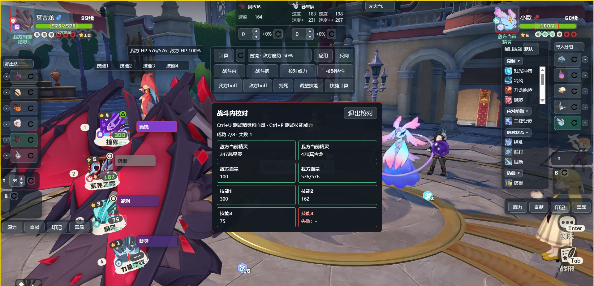

校对完毕后点击"保存布局"


### 校对战斗开始框
**战斗开始框**：包含 6 个敌方图像框，用于识别战斗开始时的敌方队伍。 
等我大师后补上

### 获取图像
[使用另一个项目](https://github.com/180sans/roco-icon-rawler)爬取并获取图标文件夹。图标独立存放在用户数据目录：

点击"界面配置", 点击"打开配置目录",将爬取的图像文件夹放入icons目录
```text
icons\
  pet\          精灵头像 PNG
  skill\        技能图标 PNG
  element\      属性图标 PNG
  skill_type\   技能类型图标 PNG
```

按原文件名放入对应文件夹后，重启程序即可显示。

新增精灵/技能图像时，将爬取输出目录更换为当前icons目录，进行爬取，会爬取缺失的图像

## 按钮和快捷键含义

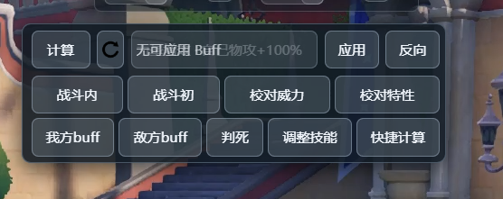

从左往右，从上至下

- "计算": 展现详细的计算结果
- "重置图标": 对局重置。不会改变我方阵容。清空敌方阵容和我方队伍状态
- "应用"和"反向": 左边的文本框显示我方携带技能的buff选项（如力量增效），"应用"代表给我方附加这个buff,"反向"代表施加这个buff的反向给我方
- "战斗内"对应ctrl+U，识别双方精灵和血量并自动切换
- "战斗初"对应ctrl+b, 识别敌方开局六个精灵
- "校对威力"对应ctrl+P, 识别并自动校对有威力叠层的技能（落雷，光能聚集）。需要1.校对识别框，2.双方精灵正确，3.其他和威力相关的双方buff正确
- "校对特性"对应ctrl+T, 识别并自动校对有伤害相关叠层的特性（恶魔狼王，布鲁斯）。需要1.校对识别框，2.双方精灵正确，3.其他和威力相关的双方buff正确。特殊说明，冥古龙的特性层数实际是等级，校对识别的是血量
- "我方buff", 对应ctrl+I, 可以手动检索我方精灵和技能库的buff技能来应用
- "敌方buff",对应ctrl+O, 可以手动检索敌方精灵和技能库的buff技能来应用
- "判死",对应ctrl+K, 显示敌方所有技能对我方的伤害，目前只显示++，+，无后缀。其中*代表技能的触发情况
- "调整技能"，对应ctrl+Y, 可以调整我方技能顺序和更换技能，这是应对传动和更换技能的情况
- "快速计算"，对应ctrl+j(计算)，ctrl+d(隐藏计算结果)。其中*代表技能的触发情况

## 特性模拟

我将特性抽象成3个类别
1. 叠层类（恶魔狼王），我按照游戏内提供的描述来编写一层是多少百分比，如恶魔狼王一层是30%。使用"校对特性"可以自动叠层
2. 触发类（古卷执行官），对于巨噬针鼹，可以在"精灵保存界面”点击闪电图标后保存，这样默认就是触发的。同理蜂后也可以在“精灵保存界面”保存五层和首领化
3. 无关伤害类

恶魔狼王特性,框内的6代表6层，也就是180%攻击力加成

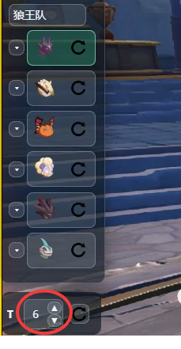

巨噬针鼹特性,框内的闪电图标变为绿色代表触发

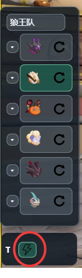

如何保存特性示例

（巨噬针鼹）

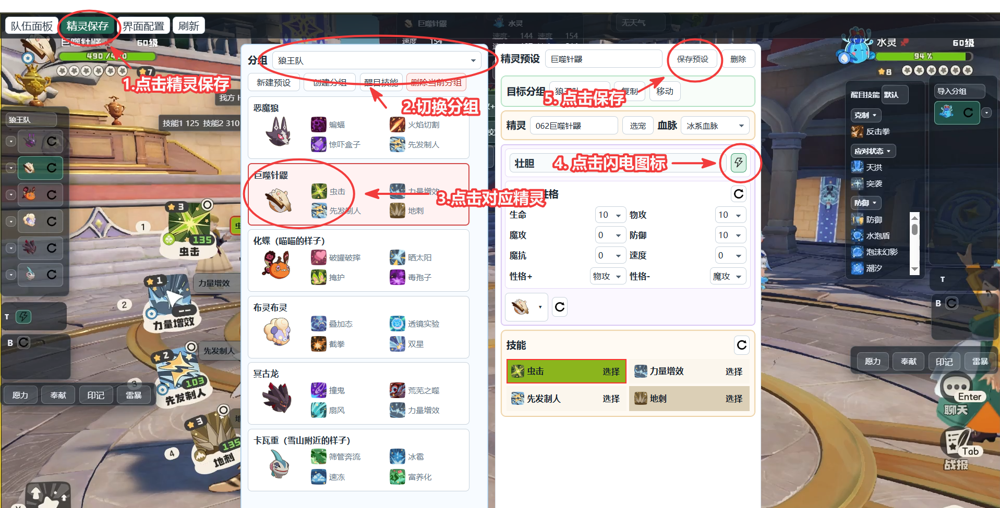

（蜂后）

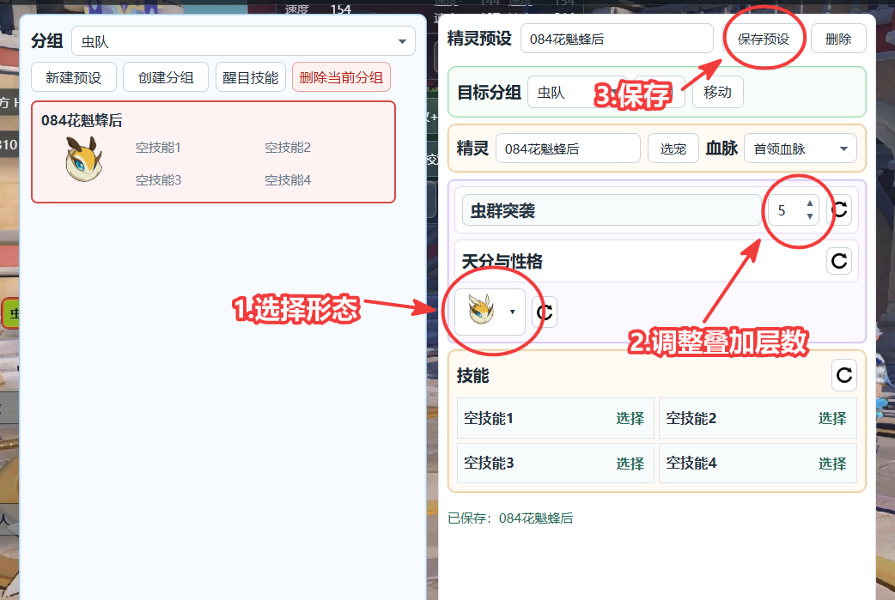

## 伤害技能模拟
我将伤害技能抽象为三个类别
1. 触发类，如龙卷风，这个的计算结果会在后面标*来提示这是触发类
2. 叠层类，如落雷，可以增加叠层数来达到游戏的，入场增加威力。使用校对威力可以自动叠层
3. 常规类，正常计算

技能的触发情况示例（暗突袭）

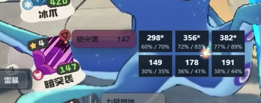

技能的叠层示例（落雷）

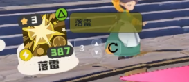

## 萌化和首领化

点击精灵的左边可以更换首领化和萌化。萌化不会替换特性，首领化会根据情况来改变特性如棋后首领不变特性，魔力猫变成武斗酷猫会改变特性

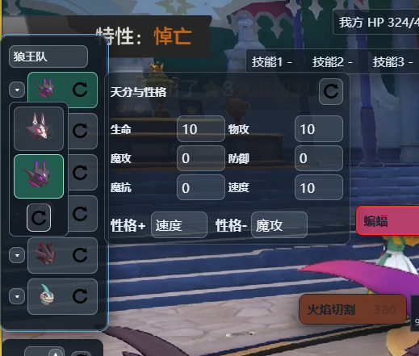


